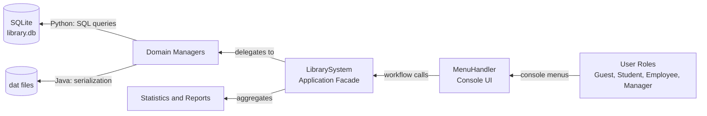

<div align="center">

# 📚 SE
### University Library Management System

**A console-based library system with four user roles and a complete borrow-request workflow, implemented in two languages — Java (file serialization) and Python (SQLite).**

[](https://openjdk.org/)
[](https://www.python.org/)
[](https://www.sqlite.org/)
[](#)
[](#)

<p>
  <a href="#-overview">Overview</a> •
  <a href="#-user-roles">User Roles</a> •
  <a href="#-project-evolution">Project Evolution</a> •
  <a href="#-architecture">Architecture</a> •
  <a href="#-installation">Installation</a> •
  <a href="#-usage">Usage</a> •
  <a href="#-testing">Testing</a> •
  <a href="#-limitations">Limitations</a>
</p>

</div>

<br>

## Contents

- [Overview](#-overview)
- [Objectives](#-objectives)
- [User Roles](#-user-roles)
- [Borrow Workflow](#-borrow-workflow)
- [Project Evolution](#-project-evolution)
- [Engineering Highlights](#-engineering-highlights)
- [Architecture](#-architecture)
- [Data Storage](#-data-storage)
- [Tech Stack](#-tech-stack)
- [Project Structure](#-project-structure)
- [Installation](#-installation)
- [Usage](#-usage)
- [Testing](#-testing)
- [Development Process](#-development-process)
- [Limitations](#-limitations)
- [About the Developer](#-about-the-developer)

<br>

## 🧭 Overview

**SE** is a University Library Management System developed for the **Software Engineering** course as a **continuation of my Advanced Programming final project**. It is a console application that manages books, students, employees, borrow requests, and borrow records for a university library.

The original Java project was reviewed against its specification, repaired, and extended into a more complete software product: a second implementation in Python with a SQLite database, an automated end-to-end test, and architecture documentation.

The same system is implemented **twice with identical behavior**:

* **Java** (`src/`) — persists data with Java object serialization (`.dat` files)
* **Python** (`python/`) — standard library only, persists data in a **SQLite** database

Both versions share the same layered architecture, business rules, and role-based menus.

<br>

## 🎯 Objectives

This project aims to:

* Continue and improve the Advanced Programming library project with a software engineering approach.
* Model a real-world library domain with clear entities and responsibilities.
* Enforce role-based access across four kinds of users.
* Implement a complete borrow-request workflow, from request to return.
* Track employee performance and library-wide statistics.
* Apply a layered architecture consistently across two implementations.
* Keep the system verifiable with an end-to-end automated test.
* Document the architecture and the development process.

<br>

## 👥 User Roles

### 🧑‍💼 Guest
- View overall statistics: registered students, total books, total borrows, and currently borrowed books.
- Search books by title only; results show book information only.

### 🎓 Student
- Register with a username and password, then log in.
- Combined book search by title, author, and publication year, including loan availability.
- Submit a borrow request with a **date range** (desired start and end dates).

### 🧑‍💻 Employee
- Register, search, and edit book information.
- Review and approve borrow requests whose start date is **today or yesterday**.
- Lend a book to a student and record the pick-up time; receive a returned book and record the return time.
- View a student's borrow history report: total borrows, undelivered books, and late returns.
- Activate or deactivate students (inactive students cannot borrow).
- Change password.

### 🧑‍⚖️ Manager
- Register new employees.
- View employee performance: books registered, books lent, and books received back.
- Borrow statistics: number of requests, total borrows, and average borrow duration.
- Student statistics, including the **top 10 students** with the most late returns.

<br>

## 🔄 Borrow Workflow

```text
┌────────────────────┐
│ Student            │
│ Submits Request    │   status: pending
│ (date range)       │
└─────────┬──────────┘
          │
          ▼
┌────────────────────┐
│ Employee           │
│ Reviews Request    │   approved  or  rejected (with reason)
└─────────┬──────────┘
          │ approved
          ▼
┌────────────────────┐
│ Employee           │
│ Lends the Book     │   pick-up time recorded
└─────────┬──────────┘
          │
          ▼
┌────────────────────┐
│ Employee           │
│ Receives the Book  │   return time recorded, late returns counted
└─────────┬──────────┘
          │
          ▼
┌────────────────────┐
│ Statistics &       │
│ Reports            │
└────────────────────┘
```

<br>

## 🌱 Project Evolution

The project started as the Java final project of the Advanced Programming course and was developed further in these phases:

| Phase | Work Done |
|---|---|
| **1. Review & Repair** | The Java code was audited against the course specification, and defects were fixed: an unreachable manager menu, a broken Exit option, a disconnected pick-up and return step, broken student report lookups, uncounted late returns, and statistics classes not wired to the menus. |
| **2. Verification** | The project was set up to build cleanly in IntelliJ IDEA, and the full borrow cycle was verified end to end. |
| **3. Publishing** | The project was published with a professional structure: README, `.gitignore`, and IDE configuration. |
| **4. Python Port** | A second implementation was added in Python, with the same behavior and rules as the Java version. |
| **5. Architecture Docs** | An architecture diagram was generated from code and added to the repository. |
| **6. SQLite Storage** | The Python version moved to a SQLite persistence layer with parameterized SQL, covered by an end-to-end test. |
| **7. Documentation** | A Mermaid data-flow diagram and repository metadata were added. |

<br>

## 📌 Engineering Highlights

- Implemented **four user roles** with role guards enforced in the application facade.
- Delivered a full **borrow-request lifecycle** (pending, approved, rejected) with pick-up and return tracking.
- Audited and repaired the original Java project against its specification.
- Built the system in **two languages with identical behavior**, keeping both implementations aligned with the same specification.
- Designed a **layered architecture**: console UI, application facade, domain managers, statistics and reports, and persistence.
- Added a dedicated **SQLite persistence layer** (`database.py`) with schema creation, seeding, and parameterized queries.
- Covered the Python implementation with a **22-check end-to-end test** that runs the whole workflow against a throwaway database.
- Documented the architecture with a **diagram generated from code** (`tools/gen_architecture.py`) and an editable Excalidraw source.
- Kept a clean history with **Conventional Commits**.

<br>

## 🏗 Architecture

### Data Flow



### Layers


The design is identical in both implementations:

| Layer | Responsibility | Main Classes |
|---|---|---|
| **Console UI** | Dynamic menus, input reading, and validation | `MenuHandler` |
| **Application facade** | Role guards, borrow workflow orchestration, delegation to managers | `LibrarySystem` |
| **Domain managers** | One manager per entity | `StudentManager`, `BookManager`, `BorrowManager`, `BorrowRequestManager`, `EmployeeManager`, `EmployeePerformanceManager` |
| **Statistics & reports** | Aggregated numbers and per-student reports | `StatisticsManager`, `BorrowStatistics`, `StudentStatistics`, `StudentBorrowReport` |
| **Persistence** | Saving and loading data | Java: `*FileManager` (serialized `.dat`) / Python: `database.py` (SQLite) |

The editable diagram source is [`docs/architecture.excalidraw`](docs/architecture.excalidraw), generated by [`tools/gen_architecture.py`](tools/gen_architecture.py).

<br>

## 🗃 Data Storage

| Version | Storage | Files |
|---|---|---|
| **Java** | Java object serialization | `books`, `students`, `employees`, `borrows` as `.dat` files, created next to the app on first run |
| **Python** | SQLite | `library.db`, created in the working directory |

The SQLite schema contains six tables:

| Table | Content |
|---|---|
| `students` | Username, name, student ID, password, active flag |
| `employees` | Username, name, employee ID, password, role (`manager` or `staff`) |
| `books` | ISBN, title, author, publication year, availability |
| `borrow_requests` | Student, book, request date, desired dates, status, rejection reason |
| `borrow_records` | Borrow, due, pick-up, and return dates with pick-up and return flags |
| `employee_performance` | Books added, edited, lent, and received, requests approved and rejected |

<br>

## ⚙ Tech Stack

| Layer | Technology | Purpose |
|---|---|---|
| Language | **Java 8+** | Original implementation, serialization-based storage |
| Language | **Python 3.8+** | Second implementation, standard library only |
| Database | **SQLite** (`sqlite3`) | Persistence for the Python version |
| Interface | **Console** | Role-based menus |
| Diagrams | **Mermaid, Excalidraw, SVG** | Architecture documentation |
| IDE | **IntelliJ IDEA** | Project configuration included |

<br>

## 📁 Project Structure

```text
SE/
│
├── src/ap/projects/finalproject/   # Java implementation
│   ├── LibrarySystem.java          # entry point (main) and core logic
│   ├── MenuHandler.java            # console menus and user interaction
│   ├── Book / Student / Employee / BorrowRecord / BorrowRequest   # models
│   ├── *Manager                    # business logic per entity
│   ├── *FileManager                # Java-serialization persistence (.dat)
│   └── BorrowStatistics / StudentStatistics / StudentBorrowReport
│
├── python/
│   ├── library_system.py           # Python implementation (same behavior as Java)
│   └── database.py                 # SQLite persistence layer (schema + queries)
│
├── tools/
│   ├── test_python_sqlite.py       # end-to-end test (Python + SQLite)
│   └── gen_architecture.py         # generates the architecture diagram
│
├── docs/
│   ├── architecture.svg
│   └── architecture.excalidraw
│
├── AGENT_PROMPTS.md                # development process log
└── README.md
```

<br>

## 📥 Installation

Clone the repository:

```bash
git clone https://github.com/ArianShayestehfard/SE.git
```

Navigate to the project directory:

```bash
cd SE
```

No external dependencies are needed. Java needs **JDK 8+** and Python needs **3.8+**.

<br>

## 🖥 Usage

### Java

**IntelliJ IDEA:** open the project folder and run `ap.projects.finalproject.LibrarySystem`.

**Command line:**

```bash
javac -encoding UTF-8 -d out src/ap/projects/finalproject/*.java
java -cp out ap.projects.finalproject.LibrarySystem
```

### Python

```bash
python python/library_system.py
```

### Default Accounts

| Role | Username | Password |
|---|---|---|
| Manager | `admin` | `1234` |
| Employee | `staff` | `1234` |

<br>

## 🧪 Testing

```bash
python tools/test_python_sqlite.py
```

The test runs the complete borrow workflow (registration, request, approval, pick-up, return, and statistics) against a throwaway SQLite database and prints one line per check.

<br>

## 🤖 Development Process

This repository was developed in a pair-programming style with an AI coding agent. The directives given to the agent, together with the outcome of each, are recorded in [`AGENT_PROMPTS.md`](AGENT_PROMPTS.md), so the evolution of the project can be followed, verified, or continued.

<br>

## ⚠ Limitations

This is an educational project and is not intended for production use.

The main limitations include:

* Passwords are stored in plain text.
* The interface is console-only, with no graphical or web front end.
* The Java and Python versions use different storage mechanisms (serialization and SQLite).
* Automated tests currently cover the Python implementation only.
* The system is single-user per run, with no concurrent access handling.

<br>

## 👤 About the Developer

<p align="center">
  <b>Arian Shayestehfard</b>
  <br>
  Computer Engineering Student at the University of Zanjan
  <br><br>
  <a href="https://github.com/ArianShayestehfard">
    
  </a>
</p>
