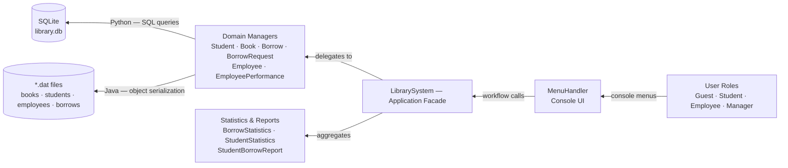
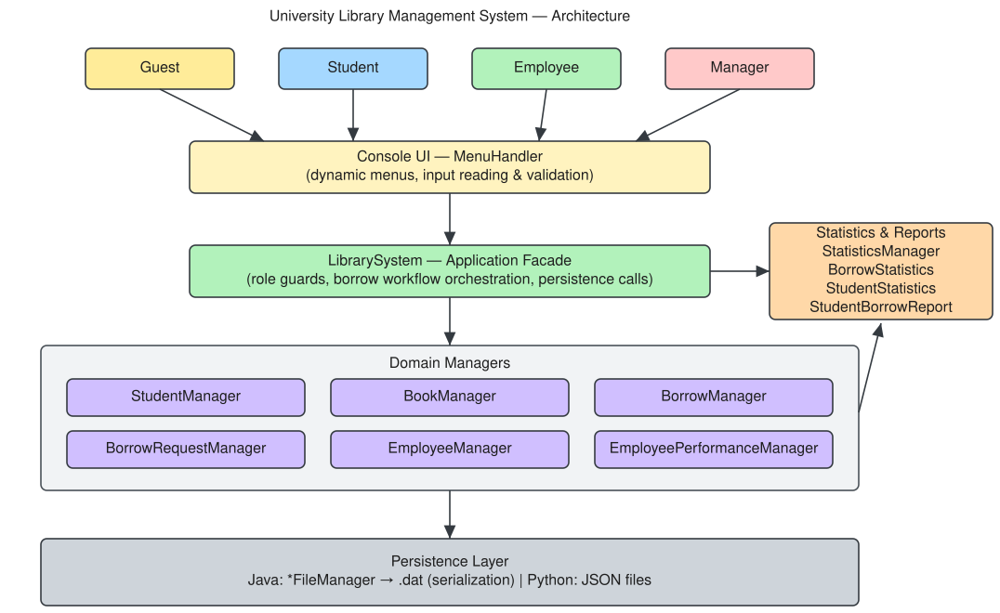

# SE — University Library Management System

University Library Management System — Advanced Programming (AP) course project.

A console-based University Library Management System implemented in **two languages**: Java (`src/`) and Python (`python/`). It covers four user roles (Guest, Student, Employee, Manager) with a full borrow-request workflow, employee performance tracking and statistics.

## Features

### Student
- Register in the system with a username and password, then log in
- Combined book search by title / author / publication year, including loan availability
- Submit a borrow request with a **date range** (desired start and end dates)

### Guest
- View overall statistics (registered students, total books, total borrows, currently borrowed books)
- Search books by title only — results show book information only

### Employee
- Register, search and edit book information
- Review and approve borrow requests whose start date is **today or yesterday**
- Lend a book to a student and record the pickup time; receive a returned book and record the return time
- View a student's borrow history report (total borrows, undelivered books, late returns)
- Activate / deactivate students (inactive students cannot borrow)
- Change password

### Manager
- Register new employees
- View employee performance (books registered, books lent, books received back)
- Borrow statistics: number of requests, total borrows, average borrow duration
- Student statistics + top 10 students with the most late returns

## Running

### Java version (`src/`)

Requires **JDK 8+**.

- IntelliJ IDEA: open the project folder and run `ap.projects.finalproject.LibrarySystem`
- Command line:

  ```bash
  javac -encoding UTF-8 -d out src/ap/projects/finalproject/*.java
  java -cp out ap.projects.finalproject.LibrarySystem
  ```

### Python version (`python/`)

Requires **Python 3.8+** (standard library only).

```bash
python python/library_system.py
```

### Default accounts

| Role | Username | Password |
|------|----------|----------|
| Manager | `admin` | `1234` |
| Employee | `staff` | `1234` |

### Testing (Python)

```bash
python tools/test_python_sqlite.py
```

Runs the complete borrow workflow (registration → request → approval → pickup → return → statistics) against a throwaway SQLite database and prints one line per check.

## Structure

```
├── src/ap/projects/finalproject/   # Java implementation
│   ├── LibrarySystem.java          # entry point (main) and core logic
│   ├── MenuHandler.java            # console menus and user interaction
│   ├── Book / Student / Employee / BorrowRecord / BorrowRequest   # models
│   ├── *Manager                    # business logic per entity
│   ├── *FileManager                # Java-serialization persistence (.dat)
│   └── BorrowStatistics / StudentStatistics / StudentBorrowReport
└── python/
    ├── library_system.py           # Python implementation (same behavior as Java)
    └── database.py                 # SQLite persistence layer (schema + queries)
```

## Architecture

### Data flow



### Layers



Layered design (identical in both implementations):

- **Console UI — `MenuHandler`**: dynamic menus, input reading and validation
- **Application facade — `LibrarySystem`**: role guards (employee / manager), orchestration of the borrow workflow, delegates to the managers
- **Domain managers**: one manager per entity — `StudentManager`, `BookManager`, `BorrowManager`, `BorrowRequestManager`, `EmployeeManager`, `EmployeePerformanceManager`
- **Statistics & reports**: `StatisticsManager`, `BorrowStatistics`, `StudentStatistics`, `StudentBorrowReport`
- **Persistence layer**: Java — `*FileManager` classes writing serialized `.dat` files; Python — JSON files

The editable diagram source is [`docs/architecture.excalidraw`](docs/architecture.excalidraw), generated by [`tools/gen_architecture.py`](tools/gen_architecture.py).

## Notes

- The Java version persists data with Java serialization (`.dat` files); the Python version stores data in a **SQLite** database (`library.db`, created in the working directory) with tables `books`, `students`, `employees`, `borrow_requests`, `borrow_records` and `employee_performance`.
- Passwords are stored in plain text — this is an educational project.
- Java sources target Java 8; the Python implementation uses only the standard library.
